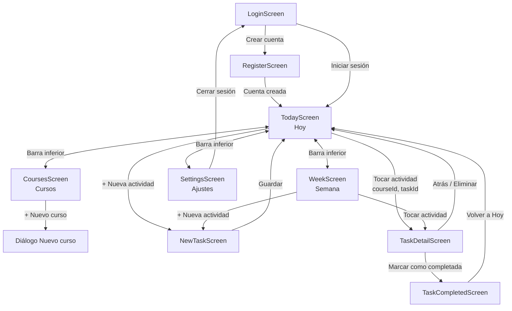
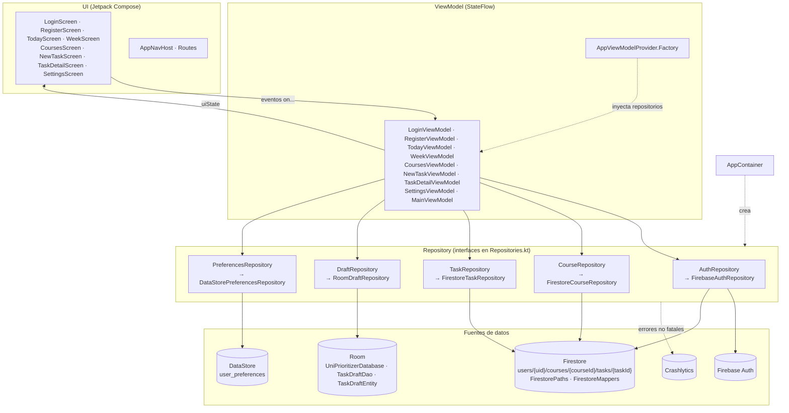

# UniPrioritizer

Equipo 2JH: Juan Espinal (251576), Jonathan Cofiño (251252), Héctor Duarte (25939).
Programación de Plataformas Móviles, Universidad del Valle de Guatemala, segundo ciclo 2026.

### LINK FIREBASE DISTRIBUTION
https://appdistribution.firebase.google.com/testerapps/1:608592192281:android:bc63c40f5dc60541259b88/releases/58bo7ep5itkt8?utm_source=firebase-console

## 1. Problema y solución

- **Usuario:** estudiantes de Ingeniería en Ciencias de la Computación de la UVG que llevan cinco cursos o más (persona: Geovanni, 20 años, 6 cursos).
- **Problema validado:** las entregas se acumulan en la misma semana y no saben por cuál empezar. En la entrevista, Geovanni contó que olvidó el informe del laboratorio de Física y lo terminó a 15 minutos del cierre.
- **Propuesta de valor:** UniPrioritizer ordena las tareas, proyectos y exámenes según su importancia y su fecha de entrega, y avisa qué días de la semana están sobrecargados. Así el estudiante sabe qué hacer primero sin armar su propio cuadro de prioridades.

## 2. Cómo ejecutar

| Requisito | Versión |
|---|---|
| Android Studio | 2026.1.2 o superior |
| JDK de Gradle | 25 (Android Studio lo descarga solo con el toolchain) |
| minSdk / targetSdk | 31 / 37 |
| Dispositivo | Emulador o teléfono con Android 12+ y Google Play Services |

1. Clonar el repositorio:
   ```bash
   git clone https://github.com/2JHUVG/Uniprioritizer.git
   ```
2. En Android Studio: **File → Open** y elegir la carpeta `Uniprioritizer`.
3. Esperar a que termine **Gradle Sync**. El archivo `app/google-services.json` ya está incluido, así que no hay que configurar Firebase.
4. Elegir el módulo `app` y un emulador, y pulsar **Run ▶**.
5. En la app, **Crear cuenta** con cualquier correo y una contraseña de al menos 6 caracteres.

Pruebas unitarias:
```bash
./gradlew testDebugUnitTest
```

## 3. Flujo de usuario



**Flujo principal:** crear cuenta → crear un curso → crear una actividad → verla en Hoy ordenada por prioridad → abrir el detalle → marcarla como completada.

## 4. Arquitectura

MVVM con repositorios e inyección manual de dependencias desde [`AppContainer`](app/src/main/java/com/example/uniprioritizer/AppContainer.kt).



- **Firestore**: datos del usuario, sus cursos y sus actividades, porque deben estar en cualquier dispositivo donde inicie sesión.
- **Room**: el borrador del formulario "Nueva actividad", porque es algo local del teléfono y debe sobrevivir a cerrar la app sin conexión.
- **DataStore**: tema (sistema, claro u oscuro) y día de inicio de la semana, porque son preferencias del dispositivo.
- Los Composables `*Screen` solo reciben estado y callbacks. Ningún archivo de `ui/` o `navigation/` importa `com.google.firebase` ni `androidx.room`.

## 5. Mínimos técnicos

Ruta base: `app/src/main/java/com/example/uniprioritizer/`

| ID | Qué se cumple | Dónde |
|---|---|---|
| M1 | Tema propio (colores y tipografía) aplicado en todas las pantallas, con modo claro y oscuro | [`Theme.kt` → `UniPrioritizerTheme`](app/src/main/java/com/example/uniprioritizer/ui/theme/Theme.kt#L58), [`Color.kt`](app/src/main/java/com/example/uniprioritizer/ui/theme/Color.kt), [`Type.kt`](app/src/main/java/com/example/uniprioritizer/ui/theme/Type.kt#L12) |
| M2 | Navigation Compose; el detalle recibe `courseId` y `taskId`; Atrás con `popBackStack()` | [`Routes.TASK_DETAIL`](app/src/main/java/com/example/uniprioritizer/navigation/Routes.kt#L13), [`AppNavHost.kt`](app/src/main/java/com/example/uniprioritizer/navigation/AppNavHost.kt#L172) |
| M3 | `LazyColumn` con `key` | [`TodayScreen.kt`](app/src/main/java/com/example/uniprioritizer/ui/today/TodayScreen.kt#L125), [`WeekScreen.kt`](app/src/main/java/com/example/uniprioritizer/ui/week/WeekScreen.kt#L123), [`CoursesScreen.kt`](app/src/main/java/com/example/uniprioritizer/ui/courses/CoursesScreen.kt#L134) |
| M4 | Formularios validados en tiempo real, error junto al campo y botón habilitado solo si es válido | [`RegisterViewModel.canSubmit`](app/src/main/java/com/example/uniprioritizer/ui/auth/RegisterViewModel.kt#L28), [`RegisterScreen`](app/src/main/java/com/example/uniprioritizer/ui/auth/AuthScreens.kt#L68), [`NewTaskViewModel.canSave`](app/src/main/java/com/example/uniprioritizer/ui/task/NewTaskViewModel.kt#L83) |
| M5 | Un ViewModel por pantalla con `_uiState` / `uiState: StateFlow` | [`TodayViewModel`](app/src/main/java/com/example/uniprioritizer/ui/today/TodayViewModel.kt#L40), [`NewTaskViewModel`](app/src/main/java/com/example/uniprioritizer/ui/task/NewTaskViewModel.kt#L104), [`TaskDetailViewModel`](app/src/main/java/com/example/uniprioritizer/ui/task/TaskDetailViewModel.kt#L45) |
| M6 | El Repository es la única puerta a los datos | [`Repositories.kt`](app/src/main/java/com/example/uniprioritizer/data/repository/Repositories.kt), carpeta [`data/repository`](app/src/main/java/com/example/uniprioritizer/data/repository) |
| M7 | Inyección manual: el ViewModel recibe el Repository por constructor | [`AppContainer`](app/src/main/java/com/example/uniprioritizer/AppContainer.kt#L28), [`AppViewModelProvider`](app/src/main/java/com/example/uniprioritizer/ui/AppViewModelProvider.kt#L20) |
| M8 | Operaciones `suspend` y `Flow` lanzadas desde `viewModelScope` | [`TaskRepository`](app/src/main/java/com/example/uniprioritizer/data/repository/Repositories.kt#L31), [`TodayViewModel`](app/src/main/java/com/example/uniprioritizer/ui/today/TodayViewModel.kt#L35) |
| M9 | Firestore: lectura en tiempo real, escritura al crear y actualización al completar; mapeo a data class de dominio | [`observeTasks`](app/src/main/java/com/example/uniprioritizer/data/repository/FirestoreTaskRepository.kt#L28), [`addTask`](app/src/main/java/com/example/uniprioritizer/data/repository/FirestoreTaskRepository.kt#L54), [`setCompleted`](app/src/main/java/com/example/uniprioritizer/data/repository/FirestoreTaskRepository.kt#L57), [`toTask`](app/src/main/java/com/example/uniprioritizer/data/remote/FirestoreMappers.kt#L52) |
| M10 | Estados de carga, error y vacío; límite de 10 s; aviso sin conexión; escrituras sin red avisan que se enviarán luego | [`StateContent.kt`](app/src/main/java/com/example/uniprioritizer/ui/components/StateContent.kt#L21), [`LOAD_TIMEOUT_MS`](app/src/main/java/com/example/uniprioritizer/ui/common/UiMessages.kt#L7), [`awaitWrite`](app/src/main/java/com/example/uniprioritizer/data/remote/FirebaseExtensions.kt#L61) |
| M11 | Room: Entity, DAO y Database; el borrador sobrevive a cerrar y reabrir la app | [`TaskDraftEntity`](app/src/main/java/com/example/uniprioritizer/data/local/TaskDraftEntity.kt#L12), [`TaskDraftDao`](app/src/main/java/com/example/uniprioritizer/data/local/TaskDraftDao.kt#L9), [`UniPrioritizerDatabase`](app/src/main/java/com/example/uniprioritizer/data/local/UniPrioritizerDatabase.kt#L9) |
| M12 | Convenciones del curso: código en inglés, sin `!!`, sin imports con `*`, sin código comentado ni restos de plantilla | Todo [`app/src/main/java`](app/src/main/java/com/example/uniprioritizer) |
| M13 | Crashlytics: los errores que captura el Repository se registran como no fatales | [`reportUnexpected`](app/src/main/java/com/example/uniprioritizer/data/remote/FirebaseExtensions.kt#L104), [`app/build.gradle.kts`](app/build.gradle.kts) |
| M14 | Build en Firebase App Distribution con notas de versión, grupo `testers` | [`firebaseAppDistribution`](app/build.gradle.kts), [`release-notes.txt`](app/distribution/release-notes.txt) |
| M15 | Flujo principal sin bugs críticos; lógica de prioridad con pruebas | [`TaskPriorityTest`](app/src/test/java/com/example/uniprioritizer/domain/model/TaskPriorityTest.kt), [`Task.kt`](app/src/main/java/com/example/uniprioritizer/domain/model/Task.kt) |

Reglas de seguridad de Firestore: [`firestore.rules`](firestore.rules). Cada usuario solo lee, escribe y borra sus propios documentos.

## 6. Alcance

**Dentro** (todas se cumplen)
- ✅ Registrar tareas, proyectos y exámenes por curso con su fecha de entrega.
- ✅ Ver las actividades ordenadas por prioridad para saber por cuál empezar.
- ✅ Estimar cuántas horas requiere cada actividad.
- ✅ Consultar la carga semanal y ver qué días están sobrecargados.
- ✅ Marcar actividades como completadas.

**Fuera**
- Recibir recordatorios antes de cada entrega: requiere notificaciones programadas, y priorizamos que el flujo principal funcione completo.
- Importar tareas desde Canvas: Canvas no da acceso a su API sin un token institucional.

## 7. Referencias y uso de IA

**Documentación consultada**
- [Jetpack Compose](https://developer.android.com/develop/ui/compose/documentation) y [Material 3 para Compose](https://developer.android.com/develop/ui/compose/designsystems/material3)
- [Navigation Compose](https://developer.android.com/guide/navigation/design#compose)
- [Guía de arquitectura de apps](https://developer.android.com/topic/architecture) y [StateFlow](https://developer.android.com/kotlin/flow/stateflow-and-sharedflow)
- [Room](https://developer.android.com/training/data-storage/room) y [DataStore](https://developer.android.com/topic/libraries/architecture/datastore)
- [Cloud Firestore para Android](https://firebase.google.com/docs/firestore/quickstart?platform=android), [acceso sin conexión](https://firebase.google.com/docs/firestore/manage-data/enable-offline) y [reglas de seguridad](https://firebase.google.com/docs/firestore/security/get-started)
- [Firebase Authentication](https://firebase.google.com/docs/auth/android/password-auth)
- [Crashlytics: excepciones no fatales](https://firebase.google.com/docs/crashlytics/android/customize-crash-reports#log-excepts) y [App Distribution con Gradle](https://firebase.google.com/docs/app-distribution/android/distribute-gradle)
- [Guía de estilo de Kotlin para Android](https://developer.android.com/kotlin/style-guide)
- Material y laboratorios de clase del curso.

**Uso de IA**
- **Herramienta:** Claude de Anthropic.
- **Para qué la usamos:** migrar los datos mock a Firestore y redactar este README.
- **Qué partes asistió:** capa de datos (`data/`) y configuración de Gradle.
- **Cómo verificamos el resultado:** compilación (`assembleDebug`), recorrido del flujo principal en el emulador con y sin conexión, revisión de los documentos en la consola de Firebase, y lectura y revisión del código por el equipo.
